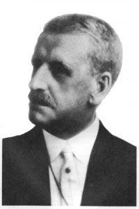
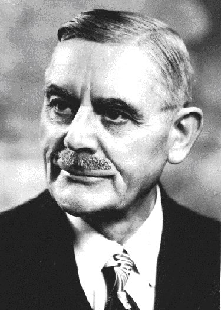
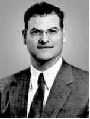

## ¿ Quién era James Edward Padgett ?

*Por [Alan Ross](http://www.jamesepadgett.com/biography-of-james-e-padgett.html).*

James Edward Padgett nació el 25 de agosto de 1852 en Washington, DC. Asistió al Instituto de la Academia Politécnica en New Market, Virginia, y en 1880 fue admitido en el colegio de abogados. A partir de entonces, ejerció la abogacía en la capital de la nación durante cuarenta y tres años hasta su fallecimiento en 1923. Padgett no era espiritista sino metodista y enseñaba en la escuela dominical en la Iglesia Metodista Trinity en 5th St. y Seward Place, NE en Washington. No tenía experiencia previa con fenómenos psíquicos; su concepción de la doctrina religiosa era simplemente la de la Iglesia protestante.

Después del fallecimiento de su esposa, se mostró reacio a asistir a su primera sesión, pero debido a su anhelo por [Helen](/1-es-padgett-messages/1-6-1-1-es-helen-padgetts-spiritual-progression/) y ante la insistencia de sus amigos, accedió a investigar la posibilidad de contactar con ella. Durante la sesión celebrada en la casa de la Sra. Maltby, ella describió a Helen perfectamente y le dijo a Padgett que su esposa quería ponerse en contacto con él y que acudiría a él desde su hogar espiritual. La médium reconoció que esto estaría dentro de la capacidad psíquica de Padgett para vincularse con Helen y registrar sus pensamientos. Su soledad lo motivó a seguir las instrucciones de la señora Maltby e intentar esta empresa poco ortodoxa.

Por las noches, después del trabajo, en su estudio, Padgett se sentaba frente a su escritorio con un lápiz en la mano, esperando pacientemente tener noticias de su querida difunta esposa. Con el tiempo, su mano se movió y garabateó caracteres en forma de pergamino que describió como "anzuelos" y "perchas". Pronto escribió una breve nota firmada por Helen indicando que ella estaba presente a menudo con él en su forma espiritual y que se alegraba de poder acercarse a él de esta manera.

Padgett no estaba convencido de que la carta procediera realmente de su difunta esposa y, como abogado práctico, pidió pruebas. En los meses siguientes, Helen, a través de sus cartas, brindó relatos de sus vidas que sólo ellos dos habían compartido. Padgett pensó que incluso esto podría explicarse como si viniera de su propia mente, excepto que los escritos llegaban en una rápida secuencia de palabras conectadas que no le dejaban tiempo para pensar. De hecho, insistió en que no tenía una idea clara de lo que escribía el lápiz hasta que lo leyó después. Además, muchos de los detalles de su vida juntos que él había escrito sólo Helen los habría recordado.

Helen continuó escribiendo y se mantuvo firme en que sus cartas se originaban en su mente y no en la de él. En este punto, Padgett comprendió con fuerza que este fenómeno no podía haber sido creación de su propia imaginación. Se vio obligado a aceptar las pruebas de las comunicaciones de Helen con tanta seguridad como cualquier prueba que hubiera escuchado en un tribunal de justicia. Ahora le resultaba evidente la verdad de que su esposa estaba viva y bien, viviendo en otra dimensión, y que ella podía transmitirle sus pensamientos y él podía escribirlos.

Luego, las sesiones de escritura dieron un giro de lo personal a lo espiritual. Padgett aprendió que a través de la oración podía mejorar la condición de su alma, aumentar su vibración y desarrollar en mayor grado sus poderes psíquicos. Esto le permitiría vincularse con espíritus de un orden superior y recibir su instrucción. Padgett pudo realizar esta tarea mediúmnica porque tenía la capacidad mental de hacer que su mente fuera completamente pasiva, de modo que pudiera usarse como un canal claro para escribir con precisión lo que los espíritus querían transmitir.

Una vez que Helen estableció su identidad, le explicó a su esposo que los habitantes de los reinos superiores que poseían conocimientos sagrados y que el mismo Jesús vendrían a traer sus enseñanzas perdidas a la humanidad una vez más. No se sabe cuándo se recibió el primer mensaje firmado "Jesús de la Biblia" porque Padgett lo consideró absurdo y lo desechó. El Sr. Colburn, que formaba parte de la comunidad, declaró que no podía estar convencido de que Jesús realmente le hubiera escrito. Aunque sus amigos tuvieron la instintiva sensación de que el mensaje era genuino.

El mensaje más antiguo de Jesús que se conserva, fechado el 28 de septiembre de 1914, le dice a Padgett que ciertos pasajes del “Nuevo Testamento”, aunque él creía plenamente, no eran ciertos. Jesús afirmó que él no nació de una virgen, su muerte no pagó el precio por el pecado, ni es Dios para ser adorado. Dios tampoco es espíritu solamente, sino que es alma, no el alma que está en el ser humano creado, sino el alma que es Deidad, cuya entidad es el único gran hecho en el universo del ser.

Padgett seguía dudando, pero en una carta Jesús le dijo que tuviera fe en que era él, el Jesús de la Biblia y lo animó a orar con frecuencia y que pronto sabría la verdad. A medida que Padgett se desarrolló psíquicamente, llegó a la conclusión de que había sido elegido como el instrumento mortal mediante el cual se le impartiría un gran conocimiento espiritual para beneficio de la humanidad. Padgett nunca practicó su mediumnidad como medio para ganar dinero, sino que se dedicó por completo a la recepción de los mensajes firmados por Jesús y sus discípulos.

Cabe preguntarse si un evento espiritual tan importante tuvo lugar, ¿por qué ha pasado desapercibido todos estos años? La razón es que Helen sufrió una larga enfermedad que agotó los ahorros de Padgett, él estaba criando a sus dos hijos y tuvo que seguir ejerciendo la abogacía para mantener a su familia. Padgett seguramente se dio cuenta de que si revelaba su mediumnidad, podría poner en peligro su reputación y su carrera de abogado, su único medio de sustento. Por lo tanto, decidió mantener sus escritos en privado, revelándolos sólo a sus amigos más confiables: el Dr. Leslie Stone, Eugene Morgan, Rollison Colburn y el Dr. Goerger.

No fue hasta el fallecimiento de Padgett, nueve años después, que sus escritos pudieron hacerse públicos sin repercusiones. La tarea de publicarlos recayó en su amigo más cercano, el Dr. Stone. Producir el primer libro de escritos fue una tarea considerable porque con el estilo de escritura automática de Padgett las palabras están interconectadas sin interrupciones ni puntuación. Sin embargo, el Dr. Stone perseveró y completó su libro de "mensajes", como él los llamó, en 1940. Desafortunadamente, para entonces, la popularidad del espiritismo en Estados Unidos había disminuido dramáticamente, principalmente debido a la exitosa campaña del célebre escapista Harry Houdini, para exponer el fraude en la sala de sesiones.

Houdini logró desacreditar a los médiums espiritistas hasta tal punto que el espiritismo se convirtió en una mera sombra de lo que era antes, con iglesias cerrando y médiums retirándose. Este momento desfavorable para un libro sobre el tema del espiritismo contribuyó marcadamente a la oscuridad de James Padgett y su obra mediúmnica. Sin embargo, un grupo pequeño pero dedicado encabezado por el Dr. Stone continuó transcribiendo y publicando los escritos de Padgett hasta que hoy existen cuatro volúmenes importantes.

En el otoño de 1954, el Dr. Stone conoció al Dr. Daniel G. Samuels en Washington, DC, y surgió una amistad duradera. El Dr. Samuels se graduó en el City College (Nueva York) en 1930 y obtuvo una maestría en la Universidad de Columbia en 1931 y su doctorado. en filosofía en 1940. En noviembre de 1954, el Dr. Samuels comenzó a aprender escritura automática, y pronto otros miembros del grupo se dieron cuenta de que había sido elegido para ser el segundo instrumento mortal para continuar donde lo dejó Padgett. Escribió automáticamente mensajes de Jesús durante once años hasta su fallecimiento en 1966.

El trabajo de Padgett representa una revelación espiritual decidida que estaba destinada al espiritismo, pero que nunca llegó a sus manos. Creo que ambos médiums merecen ser conocidos porque sus escritos espirituales pueden dar sentido al mundo y aliviar el miedo a la muerte.
Aunque Padgett y su voluminoso trabajo no han sido descubiertos durante el último siglo, estoy seguro de que merecen una investigación.

Alan Ross
